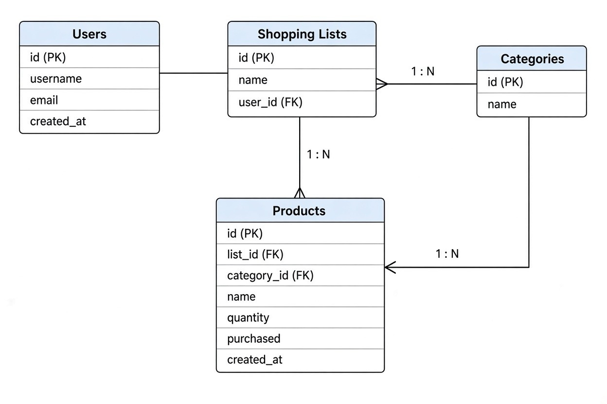

# Процесс проектирования и нормализации базы данных

## 1. Исходная (денормализованная) структура
Для демонстрации процесса нормализации мы взяли таблицу, которая хранит все данные в одном месте: 
`Items_Flat (item_id, item_name, list_name, username, user_email, category_name)`

**Проблемы:**
- **Избыточность:** Имя пользователя и email дублируются для каждого товара.
- **Аномалия обновления:** При смене email нужно обновлять его во всех товарах.
- **Аномалия удаления:** Удаление последнего товара может привести к потере данных о пользователе.

## 2. Нормализация до 1NF (Первая нормальная форма)
**Цель:** Убедиться, что все атрибуты атомарны, и в таблице нет повторяющихся групп.
**Что было не так:** Если бы мы попытались записать в одну ячейку несколько категорий через запятую, это нарушило бы 1NF.
**Наши действия:** Мы вынесли категории в отдельную таблицу `Categories`.
**Результат:** В таблице `Items` теперь хранится только `category_id` (внешний ключ).

## 3. Нормализация до 2NF (Вторая нормальная форма)
**Цель:** Устранить частичные зависимости неключевых атрибутов от первичного ключа.
**Что было не так:** В исходной таблице поля `username` зависели только от `user_id`, но не от `item_id`. Это частичная зависимость.
**Наши действия:** Мы создали отдельную таблицу `Users (user_id, username)`, а в таблице `ShoppingLists` оставили ссылку `user_id`.
**Результат:** Каждый атрибут в `Items` теперь зависит от всего первичного ключа `item_id`.

## 4. Нормализация до 3NF (Третья нормальная форма)
**Цель:** Устранить транзитивные зависимости (когда неключевой атрибут зависит от другого неключевого атрибута).
**Что было не так:** Если бы мы оставили `category_name` в таблице `Items`, то `category_name` зависело бы от `category_id`, а не напрямую от `item_id`. Это транзитивная зависимость.
**Наши действия:** Мы убрали `category_name` из таблицы `Items`.
**Результат:** Все неключевые атрибуты зависят только от первичного ключа.

## 5. Реализация связей
В нашей схеме список покупок имеет много товаров, а товар принадлежит одному списку. Связь реализована через внешний ключ `list_id` в таблице `Items`. Категории также связаны с товарами отношением «один-ко-многим».

## 6. Финальная схема

