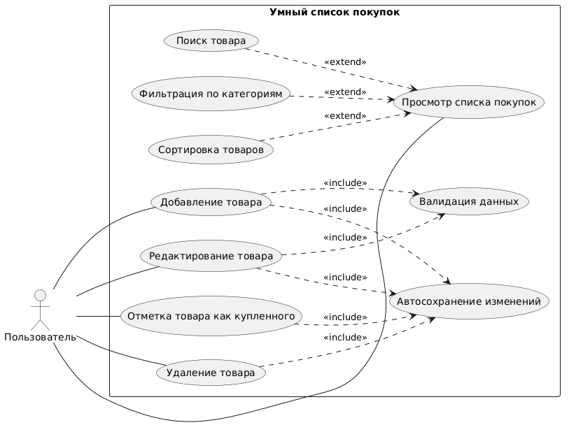
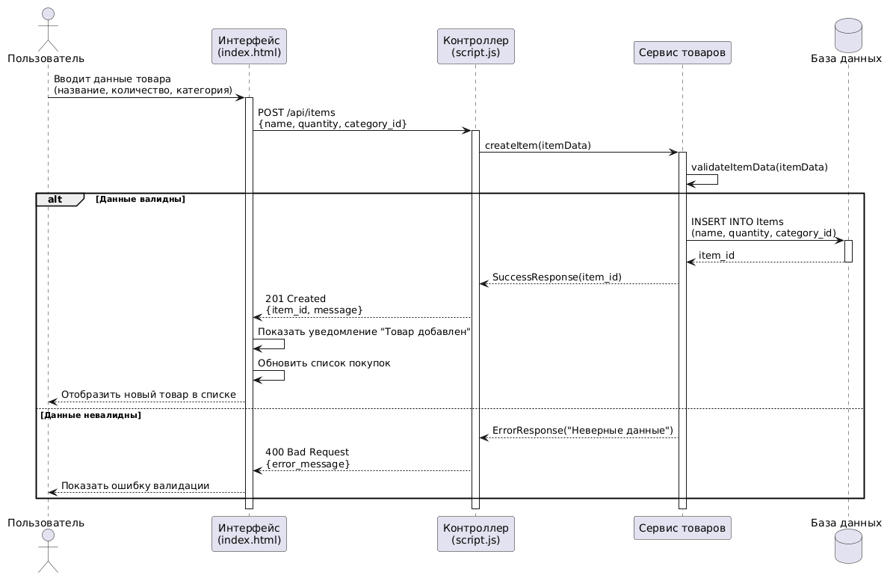
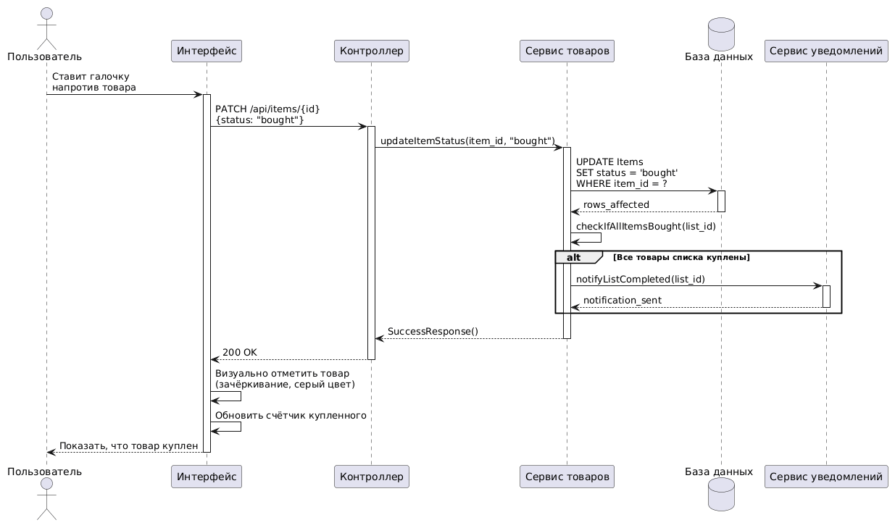
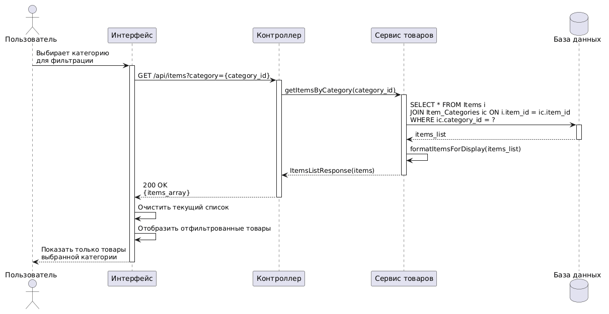
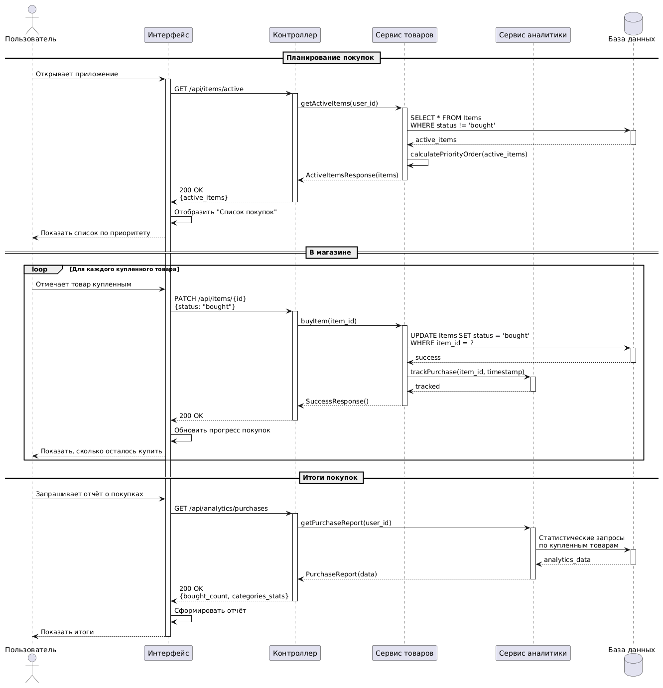

# Диаграммы поведения системы

## Use Case диаграмма

Описание основных сценариев использования приложения «Умный список покупок».

### Акторы
- **Пользователь** — основной пользователь системы.

### Основные Use Cases
- Добавление и редактирование товаров
- Просмотр, поиск, сортировка и фильтрация списка
- Отметка товара как купленного
- Удаление товаров
- Внутренние функции: валидация данных, автосохранение

## Диаграммы последовательности

### 1. Добавление товара
Процесс создания нового товара с валидацией данных.

### 2. Отметка «куплено»
Завершение покупки товара и связанные действия (проверка списка, уведомление).

### 3. Фильтрация по категориям
Механизм выборки товаров по выбранной категории.

### 4. Сценарий «поход в магазин»
Комплексный сценарий: планирование, покупки, итоги.

## Используемые инструменты
- **PlantUML** — кодовое представление диаграмм
- **draw.io** — визуальное редактирование (при необходимости)
